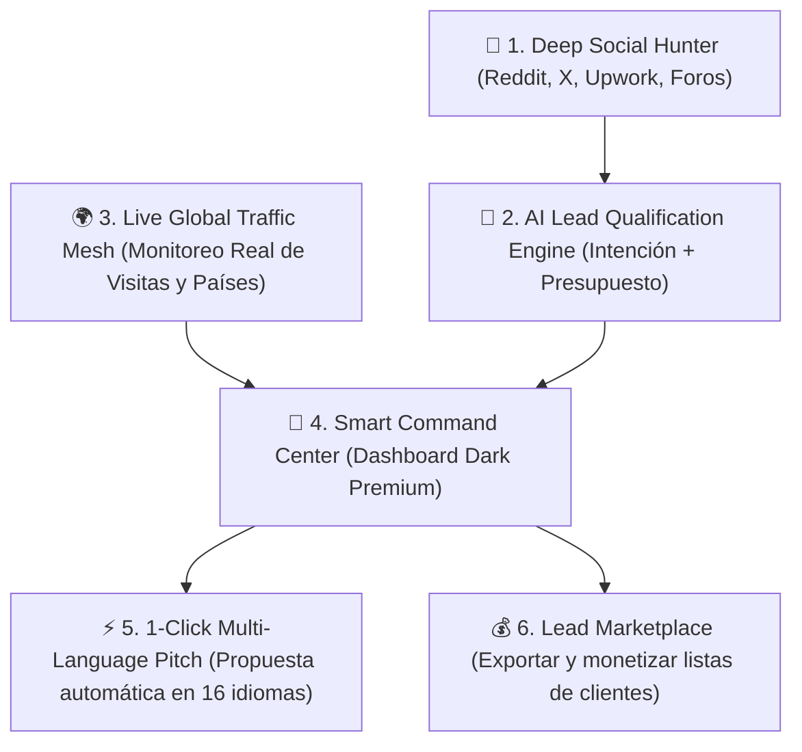

# 🚀 GROW STUDIO HUNTER & RADAR (V1.0 MASTER PLAN)
**Plataforma de Inteligencia Comercial y Adquisición Global de Clientes**

---

## 💎 Visión General: Superar la Aplicación de Referencia

La aplicación que viste en las capturas tiene buena presencia visual, pero técnicamente es solo un lector de logs básico. Para **Grow Studio**, la meta es construir una **máquina completa de adquisición y monetización de clientes de alto valor**:

---

## 🛠️ Los 5 Módulos Maestros

### 1. 📡 Lead Hunter Multicanal (Radar de Clientes en Vivo)
* **Fuentes de escucha:** Reddit (r/forhire, r/freelance_forhire, r/startups), X/Twitter, feeds RSS de trabajo y foros de negocios.
* **Filtro Semántico con IA:**
  * Descarta automáticamente a freelancers buscando trabajo y detecta **compradores reales** con necesidad activa ("Looking for a web designer...", "Need a landing page...").
  * **Score de Temperatura (0 a 100):**
    * 🔴 `FUEGO (90-100)`: Tienen presupuesto explícito ($300 - $1,500+) y urgencia de entrega.
    * 🟡 `HOT (70-89)`: Piden contacto inmediato por DM o email.
    * 🔵 `WARM (50-69)`: Dudas o consultas de costos.

### 2. 🌍 Monitor de Tráfico Global en Tiempo Real
* Panel con mapa de calor por países (US, BR, ID, ES, VE, etc.).
* Contador de sesiones activas, pico horario, fuentes de tráfico (redes, directo, bots identificados) y tiempo de permanencia.
* Detección de país e idioma del visitante para adaptar el portafolio en milisegundos.

### 3. ⚡ Generador de Propuestas con 1 Clic (16 Idiomas)
* Al hacer clic en un lead detectado (por ejemplo, el de habla inglesa que pide una web de $300):
  * La IA genera de inmediato:
    1. Mensaje de contacto persuasivo y personalizado en su idioma nativo (usando la psicología de `high-converting-copy`).
    2. Enlace directo a una demo interactiva relevante de Grow Studio (ej. una demo de restaurante, ecommerce o landing de eventos).
    3. Botón para copiar o abrir chat de una vez.

### 4. 💰 Monetización de Leads (Vender paquetes de prospectos)
* Dado que te interesó el negocio de vender leads:
  * El sistema permite exportar paquetes filtrados (ej: *"50 Leads calificados de negocios en USA que necesitan menú digital o web"*).
  * Generación de reportes limpios en PDF con el branding de Grow Studio para venderlos a otras agencias o freelancers.

### 5. 🎨 Diseño UI/UX Nivel Silicon Valley
* Interfaz con estética Dark Mode profunda (`#0A0A0C`), bordes glassmorphism con neón suave, métricas animadas y transiciones ultra fluidas (aplicando nuestro skill `app-ui-premium`).
